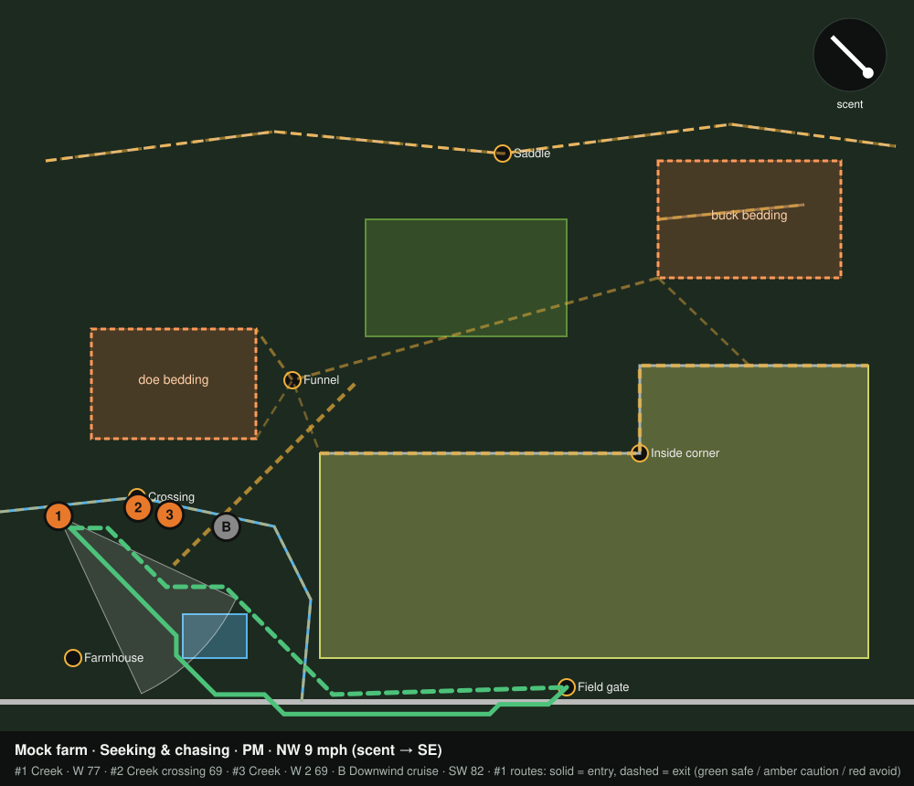

# Mature Buck Stand Planner

Pick the best stand for your next sit at a mature whitetail, and get in and out without him knowing.

React Native (Expo) app for iOS and Android. Offline-first, one-handed, glove-friendly, silent by default. US only: it uses the National Weather Service forecast, USGS 3DEP elevation, NLCD land cover, the USDA Cropland Data Layer, and USGS National Map basemaps.



*Real engine output on the built-in mock farm for a seeking-and-chasing evening with a NW wind. Every field-edge stand is eliminated because scent would roll into the beans. The picks sit on the west creek bottom, downwind-safe from both bedding areas. Solid line = entry, dashed = exit; green/amber/red = safe/caution/avoid.*

> **Planning aid only.** Wind, thermals and deer behavior are probabilistic, and map detections can be wrong. You are responsible for safe, legal and ethical hunting decisions.

## What's in Phase 1

| Deliverable | Where |
|---|---|
| Project structure (npm workspaces) | `apps/mobile`, `packages/engine`, `server/vision-proxy` |
| Data models: Property, Stand, Hunt, Sighting, WeatherSnapshot, Plan (+ habitat, routes, scores) | `packages/engine/src/models.ts` |
| Rules engine, pure TypeScript, unit-tested (101 tests) | `packages/engine/src` → [docs/RULES.md](docs/RULES.md) |
| Map-photo calibration (north, scale bar, two reference points) | engine `calibration/`, app `app/calibrate.tsx` |
| Vision analysis: Claude via your proxy, plus mock mode | engine `vision/`, `server/vision-proxy`, app `src/services/vision.ts` |
| USGS 3DEP / NLCD / CDL cross-check of detections | engine `vision/crossCheck.ts`, `landdata/usgs.ts` |
| Plan Hunt screen | `apps/mobile/app/plan.tsx` |
| Results screen (map-first, swipeable cards, tap-for-why) | `apps/mobile/app/results.tsx` |
| Offline plan card | engine `planCard.ts`, app `app/plan-card.tsx` |
| Also included: Hunt mode, post-hunt log, settings, encrypted storage | `app/hunt.tsx`, `app/log.tsx`, `app/settings.tsx`, `src/db/` |

## Quick start

Requirements: Node 22.18+ (the engine and proxy run TypeScript natively via Node's type stripping), Xcode and/or Android Studio for device builds.

```bash
npm install                       # all workspaces
npm test                          # rules engine: 101 tests, no device needed

# Mobile app (needs a dev build: MapLibre and SQLCipher are native modules)
cd apps/mobile
npx expo install --fix            # align native module versions with your Expo SDK
npx expo prebuild
npx expo run:ios                  # or run:android
```

The app starts in **mock vision mode**, so you can calibrate any photo and get a full plan offline with no API key. Detections from the mock are illustrative, not from your photo.

### Real map analysis (Claude, via your proxy)

```bash
cd server/vision-proxy
cp .env.example .env              # set ANTHROPIC_API_KEY and APP_TOKENS
node --env-file=.env src/server.ts
```

Then in the app: Settings → Map analysis → **Vision proxy**, and enter the URL and app token. The API key never ships in the app. See [server/vision-proxy/README.md](server/vision-proxy/README.md).

## How a plan is made

1. **Season phase** from date + state (Midwest calendar: early season → October lull → pre-rut → seeking/chasing → lockdown → post-rut → late season). Always overridable.
2. **Map features** from the vision model (ridges, saddles, benches, draws, creek crossings, thick cover, ag fields, mast, edges, roads, funnels) with confidence, cross-checked against 3DEP elevation, NLCD and CDL when the photo is geo-referenced. The hunter can move, retype or dismiss every one.
3. **Habitat inference**: probable buck/doe bedding, phase-weighted food, and travel corridors (bed→food, bed↔bed cruising, downwind cruise lines, benches/edges/draws), bent through saddles, funnels and crossings.
4. **Candidates** on the downwind side of corridors, inside shooting range, outside a phase-specific bedding setback, never on top of a trail. Your own stands are always evaluated and always shown.
5. **Wind gate**: a stand is eliminated if its scent plume reaches bedding, the food deer are using, or their approach path. Gusts and forecast swings widen the plume. Below 6 mph, thermals take over (downslope at dawn and last light, upslope midday).
6. **Score** 0–100: wind fit 25 · access stealth 20 · movement 20 · bedding distance 10 · shot 10 · cover 5 · pressure 5 · weather/time 5.
7. **Top 3 + backup** with a different wind tolerance. Each one gets a one-line reason, best sit window, 16-sector wind dial, color-coded separate entry and exit routes, a shot plan with no-shot lanes, its two biggest risks, a confidence level, and GO / CAUTION / NO-GO.
8. **Moon phase and pressure trend** are low-confidence modifiers: capped at ±0.75 points, visibly tagged, and damped when you have observed data near the stand.

## Safety and privacy

- Harness reminder on every stand; check-in timer with emergency contact (vibrate-only reminders, plus a one-tap pre-filled text when you're overdue).
- No shot lanes toward roads or houses within weapon danger distance; expected shots never exceed your stated effective range.
- Weather no-go: thunderstorms, freezing rain, gusts ≥ 35 mph, wind chill ≤ −15°F. Cautions below those.
- Legal shooting hours on every screen and card, plus regulation, CWD and blaze-orange reminders.
- **Encrypted local storage** (SQLCipher; key in the iOS Keychain / Android Keystore). No accounts, no analytics. Sharing is off by default and is always a deliberate tap.

## Repository layout

```
packages/engine/        Pure TS rules engine + data clients (no React Native)
  src/models.ts         Data models
  src/planner.ts        planHunt(): orchestrates everything below
  src/season/           Phase calendar, setbacks, corridor weights, sit windows
  src/inference/        Bedding, food, corridors
  src/wind/             Scent plumes, thermals, wind gate, wind margin
  src/stands/           Candidates, A* entry/exit routing, scoring
  src/safety/           Weather gates, shot lanes, reminders, disclaimer
  src/modifiers/        Moon + pressure (low confidence)
  src/calibration/      Photo ↔ local meters ↔ lat/lon
  src/vision/           Schema/validator, prompt, mock, client, 3DEP/NLCD/CDL cross-check
  src/weather/nws.ts    api.weather.gov client + parsers
  src/landdata/usgs.ts  EPQS (3DEP), NLCD WMS, CropScape (CDL), CONUS Albers
  src/planCard.ts       Offline plan card + share text
apps/mobile/            Expo Router app
  app/                  Screens: index, calibrate, features, plan, results, plan-card, hunt, log, settings
  src/components/       PhotoMap (SVG), GeoMap (MapLibre), StandCard, WindDial, ScoreSheet, WindBadge…
  src/db/               Encrypted SQLite (SQLCipher) + repositories
  src/services/         Weather, vision, land data, offline map packs, check-in, device
server/vision-proxy/    Node proxy → Claude (structured JSON output), auth + rate limiting
docs/                   RULES.md (engine rationale), ARCHITECTURE.md, plan preview
```

## Status and known gaps

See [docs/ARCHITECTURE.md](docs/ARCHITECTURE.md#status) for what's verified, what isn't yet, and the Phase 2 list.
